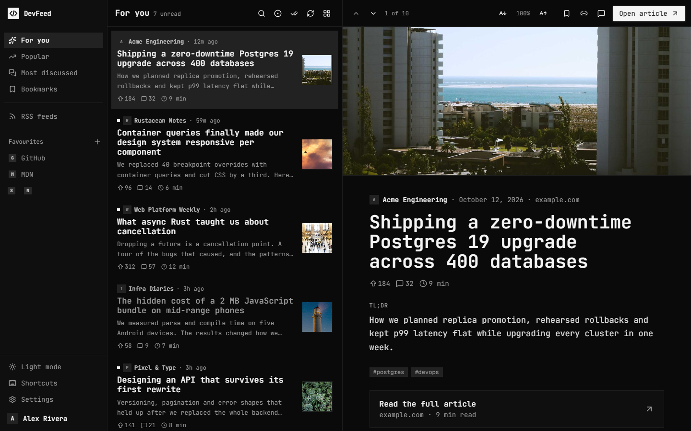
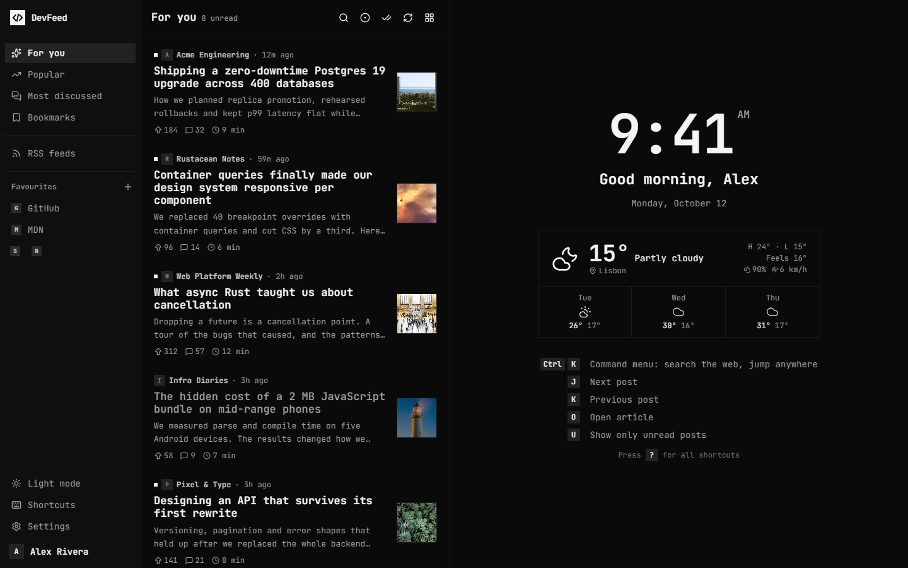
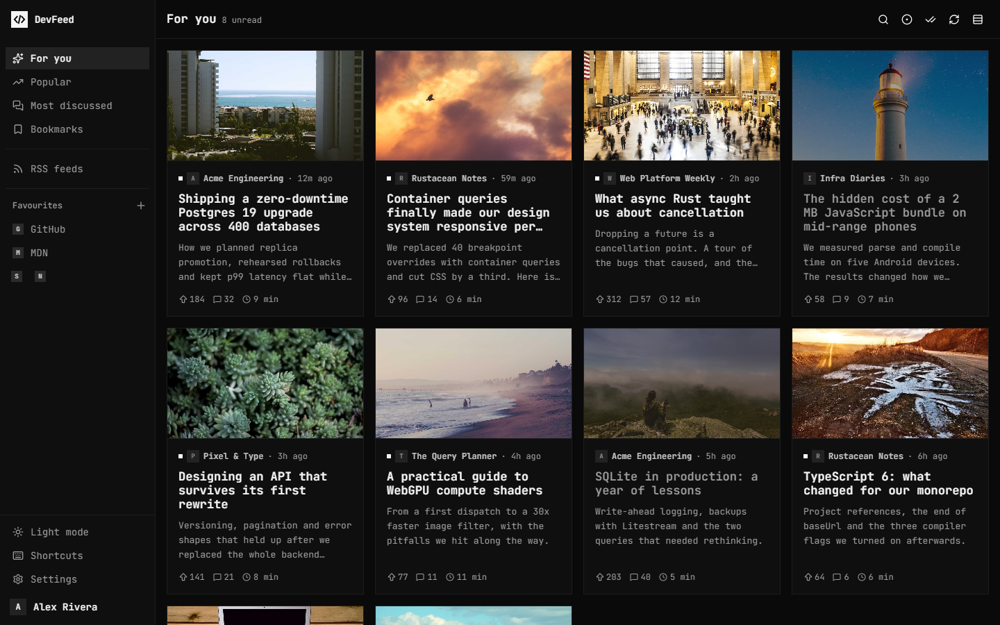
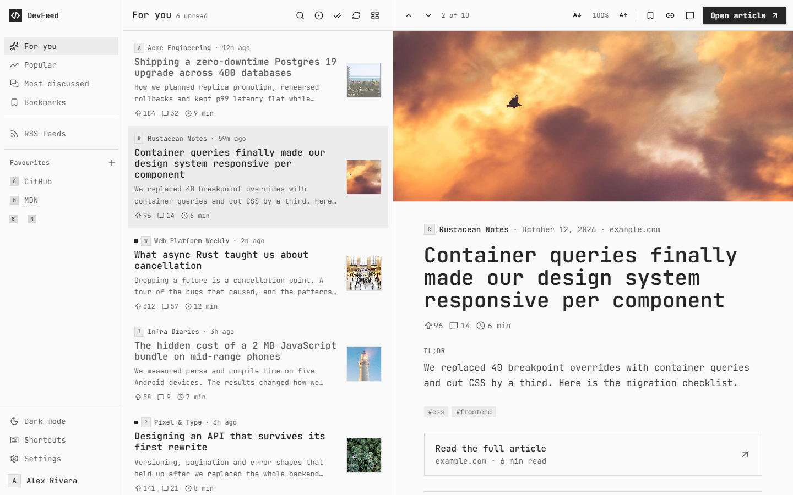
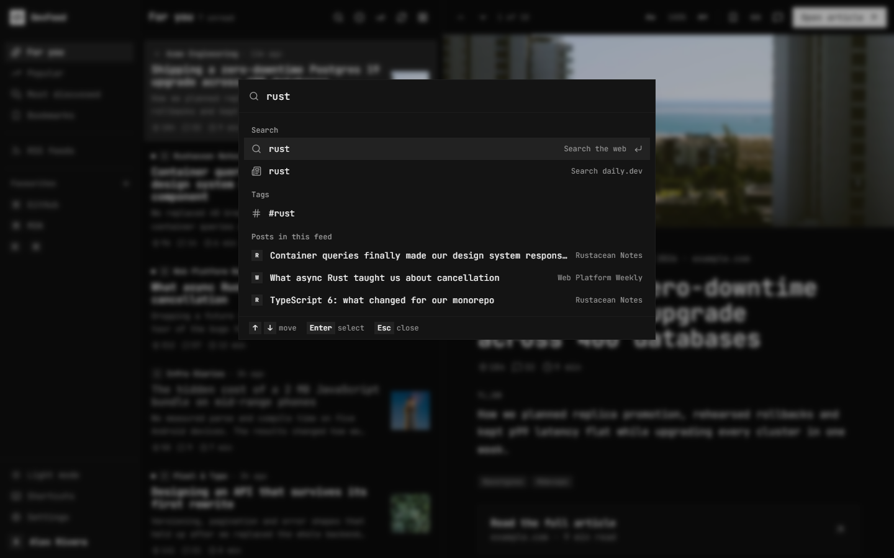
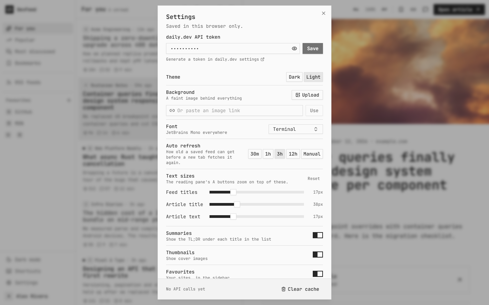

<p align="center">
  
</p>

<h1 align="center">DevFeed</h1>

<p align="center">
  A new tab page for developer news: daily.dev feeds, RSS, a reading pane, favourites and the weather.<br />
  Black and white, square corners, built to be read from the keyboard.
</p>

<p align="center">
  
</p>

**Try DevFeed:**

[Chrome Web Store](https://chromewebstore.google.com/detail/devfeed/affcchmbnpheehkaahcmgfppjjaagank)  
[Firefox Add-ons](https://addons.mozilla.org/en-US/firefox/addon/devfeed/)

## What it does

Every new tab opens on three columns: your feeds on the left, the post list in the middle and a reading pane on the right. Open a post to read its summary, or its full text when an RSS feed includes it, then press `O` to go to the article. Until you pick a post, the reading pane shows a clock, the weather and your shortcuts.

News comes from two places:

- **daily.dev:** For you, Popular, Most discussed and Bookmarks, through daily.dev's GraphQL API. These use the daily.dev login your browser already has, so there is no token to copy.
- **RSS and Atom:** Hacker News, web.dev, GitHub Blog, Cloudflare Blog and DEV are on by default, 14 more are one switch away, and you can add any feed by URL. These need no daily.dev account.

## Screenshots

| Welcome screen                                                                                                                                           | Card view                                                                                                                                       |
| -------------------------------------------------------------------------------------------------------------------------------------------------------- | ----------------------------------------------------------------------------------------------------------------------------------------------- |
|  |                                           |
| **Light mode**                                                                                                                                           | **Command menu** (`Ctrl+K`)                                                                                                                     |
|                                                            |  |
| **Settings**                                                                                                                                             |                                                                                                                                                 |
|           |                                                                                                                                                 |

## Features

### Reading

- **Reading pane** with the cover image as a header, then the title, stats, TL;DR and tags. RSS posts that include the full article show it right there, cleaned down to plain article formatting.
- **Comments on request.** daily.dev comments load only when you press `C`, since each load costs one API request. The last 25 threads are saved.
- **Text size.** Sliders in Settings for feed titles, the article title and article text; `-` and `+` zoom the reading pane from 50% to 200%.
- **Unread tracking.** Unread posts have a dot, `U` shows only unread posts, and "Mark all as read" marks every loaded post as read.
- **Two layouts.** The three-column reader, or a full-width card grid that opens posts in a side panel.
- **Infinite scroll.** The next page loads as you near the end of the list, or when you press `J` on the last post.

### Feeds

- **daily.dev:** For you, Popular, Most discussed (past week, month or year) and Bookmarks. Bookmarks sync with your account.
- **RSS:** 19 built-in developer feeds. Filter the merged timeline by source, and add your own feeds in **Manage feeds**.
- **Search:** the command menu searches daily.dev, the web (with your browser's default engine) and the posts already loaded.

### New tab

- **Welcome screen** with a large clock, a greeting and the weather from [Open-Meteo](https://open-meteo.com): current conditions, today's high and low, and a 3-day forecast.
- **Favourites** in the sidebar. Leave the name empty for an icon-only shortcut; right-click to edit, drag to reorder.
- **Command menu** (`Ctrl+K` or `/`): type a web address to open it, or jump to a favourite, feed, tag, post or setting.

### Look

- **Dark by default**, with light mode one click away.
- **12 font presets**, from JetBrains Mono (the default) to Inter, Plus Jakarta Sans, IBM Plex and serif options such as Newsreader and Literata.
- **Background image:** upload a picture or paste a link. It sits behind everything at 15% opacity, with sliders for opacity and blur.

## Keyboard

| Key                 | Action                                |
| ------------------- | ------------------------------------- |
| `J` / `K`           | Next / previous post                  |
| `O`                 | Open the article                      |
| `B`                 | Bookmark (daily.dev posts)            |
| `C`                 | Load comments (daily.dev posts)       |
| `U`                 | Show only unread posts                |
| `Ctrl` + `K` or `/` | Command menu                          |
| `-` / `+` / `0`     | Smaller / larger / reset reading text |
| `R`                 | Refresh the feed                      |
| `?`                 | All shortcuts                         |

## Install

DevFeed isn't in an extension store yet, so you load it unpacked.

**From a release:** download the zip for your browser from the [latest release](https://github.com/Ademking/DevFeed/releases/latest): `devfeed-chrome-v*.zip` for Chrome, Edge and Brave, or `devfeed-firefox-v*.zip` for Firefox. Unzip it and load it as described below.

**From source:**

```bash
npm install
npm run package
```

This builds `dist/` (Chrome, Edge, Brave) and `dist-firefox/` (Firefox), and zips both into `release/`.

Then load the unzipped folder for your browser:

- **Chrome, Edge or Brave:** open `chrome://extensions` (`brave://extensions` in Brave), turn on **Developer mode**, click **Load unpacked** and pick the folder.
- **Firefox 140 or later:** open `about:debugging#/runtime/this-firefox`, click **Load Temporary Add-on** and pick `manifest.json` in the Firefox folder (or the Firefox zip itself). A temporary add-on is removed when Firefox restarts; installing it permanently needs a build signed by Mozilla. Site icons fall back to letters in Firefox, which has no favicon API for extensions.

Open a new tab. RSS feeds, favourites and the welcome screen work straight away. To load the daily.dev feeds, [sign in to daily.dev](https://daily.dev) in the same browser, then press _Check again_ on the card in the For you feed. DevFeed reads the session the browser already has, so there is nothing to copy.

**After rebuilding,** click **Reload** on the extension. The browser picks up new JavaScript by itself, but only applies `manifest.json` changes, such as new permissions, on reload. RSS feeds failing with CORS errors usually mean the extension needs a reload.

## Privacy and permissions

Settings, favourites and read history stay in the extension's own storage in this browser. There is no DevFeed account and no token: daily.dev feeds reuse the daily.dev session cookies your browser already holds, and they are sent only to daily.dev. Nothing is sent to a DevFeed server; there isn't one.

| Permission                                 | Why                                                                                       |
| ------------------------------------------ | ----------------------------------------------------------------------------------------- |
| `https://api.daily.dev/*`                  | Load daily.dev feeds, comments, bookmarks and your profile, using your browser's daily.dev session cookies. |
| The 19 built-in feed sites                 | Read their RSS feeds. Feed sites don't allow cross-site requests otherwise.               |
| Optional: any `https://` or `http://` site | Asked for one site at a time, only when you add a custom feed.                            |
| `favicon`                                  | Show site icons from the browser's own cache instead of a third-party icon service.       |
| `search`                                   | "Search the web" uses your browser's default search engine.                               |
| `geolocation`                              | "Use my location" for the weather. Only when you click it.                                |

Other services DevFeed talks to:

- **Open-Meteo** for weather and city search. It receives the coordinates of the place you picked.
- **GeoJS**, with **ipwho.is** as a backup, only if you click "Use my location" and the browser can't give a position (Brave turns that off by default). They see your IP address and return an approximate city.
- **Image hosts** for post thumbnails, and the link you paste if you use a background image link.

## How daily.dev access works

DevFeed has no login and no API key. It calls daily.dev's GraphQL API with the session cookies your browser already has for daily.dev, so whatever your account can read there works here too. Requests go only to `api.daily.dev`.

- A feed is refetched only when its saved copy is older than **Auto refresh** (3 hours by default, or Manual).
- Posts load 40 at a time, and each extra page is one request.
- Your profile is fetched at most twice a day, and comments only when you ask.
- RSS feeds never touch daily.dev.

If you're signed out of daily.dev, the daily.dev feeds ask you to sign in; RSS feeds, favourites and the welcome screen keep working.

## Development

```bash
npm run dev          # Vite dev server at http://localhost:5173
npm run build        # Type-check and build the extension into dist/
npm run package      # Build, add dist-firefox/, and zip both into release/
npm run icons        # Regenerate the PNG icons in public/icons
npm run screenshots  # Recapture docs/screenshots (needs npm run dev running)
```

The dev page runs on `localhost`, where the browser won't send daily.dev's cookies, so the dev server proxies `/daily-graphql` to the daily.dev GraphQL API (forwarding the cookie pasted into the dev-only field of the Connect card as a `Cookie` header) and `/rss-proxy?url=` to feeds. The built extension calls them directly through its host permissions.

The Firefox build is the same code with a different manifest: it drops the Chrome-only `favicon` permission and adds `browser_specific_settings.gecko` with the add-on ID, a minimum version of Firefox 140 and the `data_collection_permissions` that addons.mozilla.org requires (daily.dev authentication and the weather location). See `scripts/package.mjs`.

`npm run screenshots` drives an installed Chrome in headless mode with a temporary profile. Set `CHROME_PATH` if Chrome isn't in the default location.

**Stack:** React 19, TypeScript, Vite, Tailwind CSS v4, and [Shark UI](https://shark-ui.com) components (built on [Ark UI](https://ark-ui.com)) added with the shadcn CLI. Add more with `npx shadcn@latest add @shark/<component>`.

```
public/            manifest.json, icons, theme.js (applies theme and font before first paint)
src/App.tsx        layout, feeds, keyboard shortcuts
src/components/    sidebar, post list and cards, reading pane, welcome screen, dialogs
src/hooks/         daily.dev feed, RSS, comments, weather, profile
src/lib/           API client, RSS parser, HTML sanitizer, storage, fonts, weather
scripts/           icon generator, screenshot capture
```

## Credits

News from [daily.dev](https://daily.dev) and the publishers of each RSS feed. Weather and geocoding from [Open-Meteo](https://open-meteo.com). Sample images in the screenshots from [Lorem Picsum](https://picsum.photos). DevFeed isn't affiliated with daily.dev.
